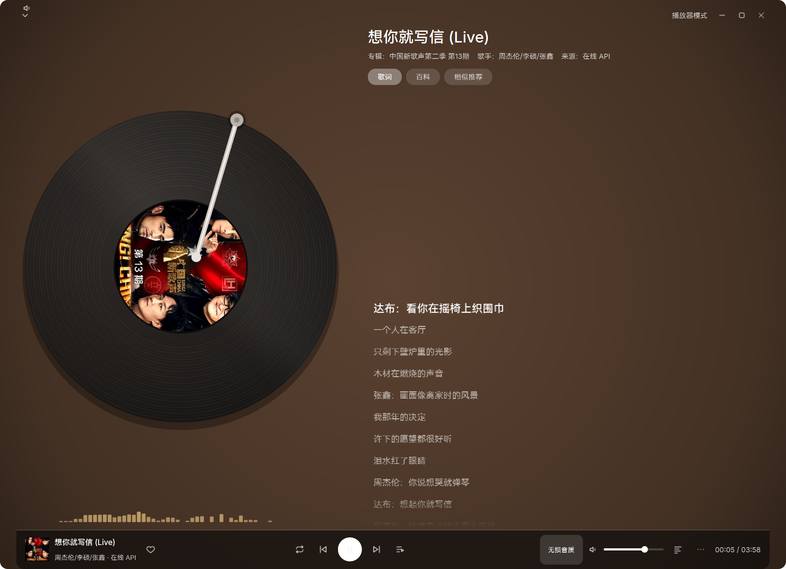
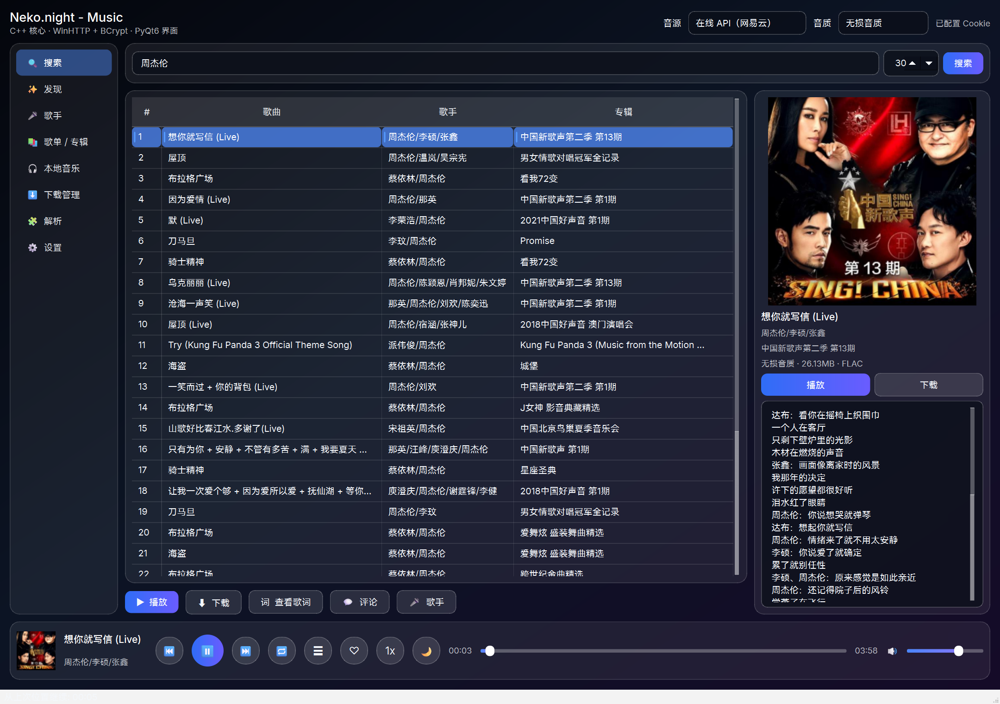
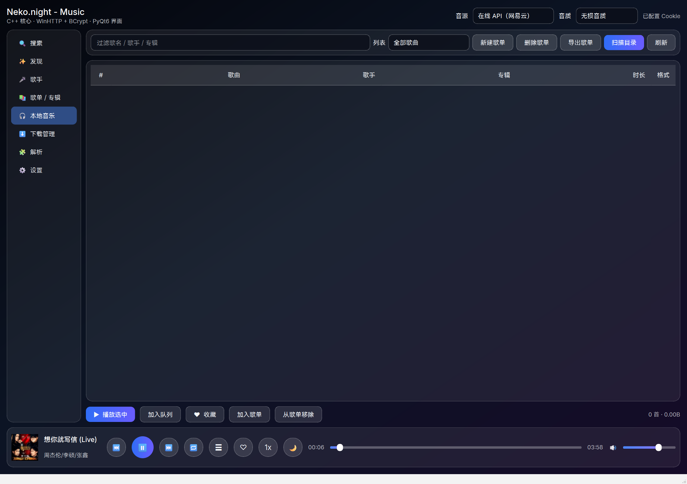
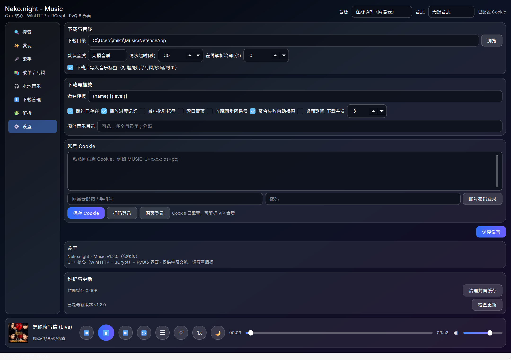

# Neko.night - Music

C++ 核心 + PyQt6 界面的 Windows 桌面网易云音乐工具。

> 本仓库提供安装程序下载与完整源码（PyQt6 UI + C++ 核心）；不包含任何用户 Cookie 或密钥。代码以 MIT 许可证开源。



## 下载

前往 [Releases](../../releases) 下载最新版本：

- `Neko.night-Music-Setup-x.y.z.exe`：安装版，双击安装即可
- `Neko.night-Music-Portable-x.y.z.zip`：便携绿色版，解压后运行 `NeteaseMusic.exe`，配置保存在程序目录 `config/`

系统要求：Windows 10 / 11（64 位）。发布页同时附安装包与便携版 SHA256 校验值。

国内镜像：[Gitee 仓库](https://gitee.com/Neko-night/Neko.night-music) · [Gitee 发行版下载](https://gitee.com/Neko-night/Neko.night-music/releases)

## 截图

| 搜索 | 音乐库 |
| --- | --- |
|  |  |

| 设置（检查更新 / 缓存清理） | 大播放器 |
| --- | --- |
|  |  |

## 从源码构建

```powershell
python -m pip install -r requirements.txt
.\build.ps1        # 编译 C++ 核心（需要 VS2022 + CMake）
python run.py
```

## 功能

- **本地 Cookie 直连网易云**：搜索 / 单曲 / 歌单 / 专辑 / 下载（标准～超清母带）
- **在线音源**：在线 API（网易云，无需登录即可解析）与单平台搜索（网易云 / QQ 音乐 / 酷狗）
- **登录方式**：扫码登录、网页登录（调用本机 Edge 一键登录并自动抓取 Cookie）、账号密码登录
- **本地音乐库**：扫描下载目录、自动读标签与内嵌封面、歌单（可导出 M3U8 / TXT）、播放队列、播放进度记忆
- **播放器**：大播放器（黑胶唱片 + 实时频谱 + 逐行高亮歌词）、桌面歌词（颜色 / 单双行样式）、迷你模式、倍速、睡眠定时、托盘、全局媒体键
- **发现**：每日推荐、私人 FM、新歌速递、排行榜、我的歌单；歌手页与歌曲评论
- **红心收藏**：可选择同步到网易云「我喜欢的音乐」
- **下载增强**：断点续传、失败自动重试、命名模板、跳过已存在、并发控制
- **维护**：应用内检查更新、封面缓存占用查看与一键清理
- **安全**：安装包内不含任何 Cookie 或密钥；Cookie 仅保存在本地 config 目录

## 字体

界面随包内置并自动加载以下字体，无需系统安装：

- HarmonyOS Sans SC（中文主字体，华为免费商用字体）
- Inter（西文与数字，SIL OFL 1.1）
- JetBrains Mono（时间码等宽数字，SIL OFL 1.1）

## 说明

- 本软件仅供个人学习、研究与交流使用，请勿用于商业用途。
- 本软件不提供、不存储任何音乐内容；播放与下载均使用你自己的网易云账号，
  所有音乐版权归各自版权方所有，请自觉遵守相关法律法规。

## 许可证

代码以 [MIT](LICENSE) 许可证开源。
